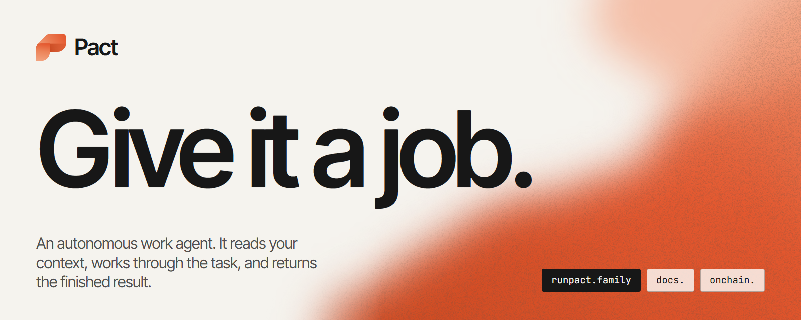
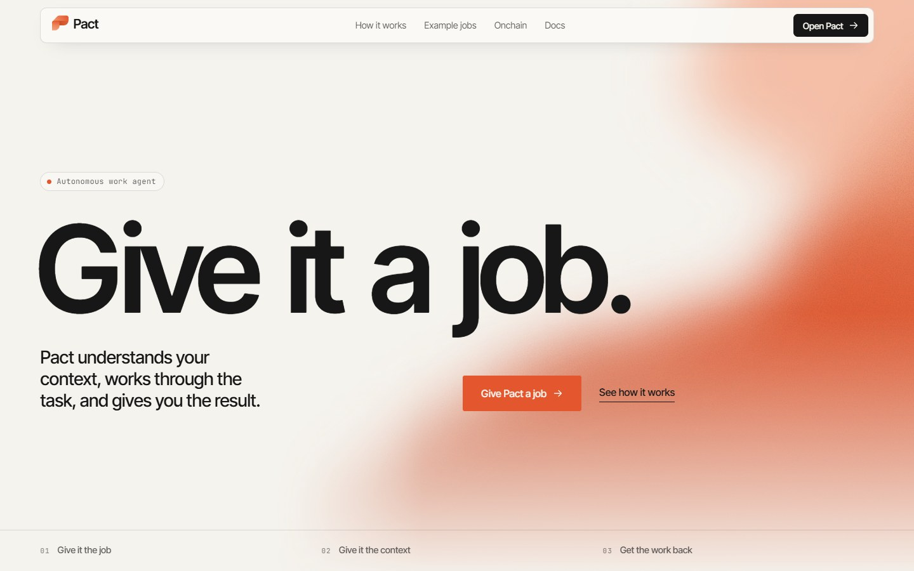
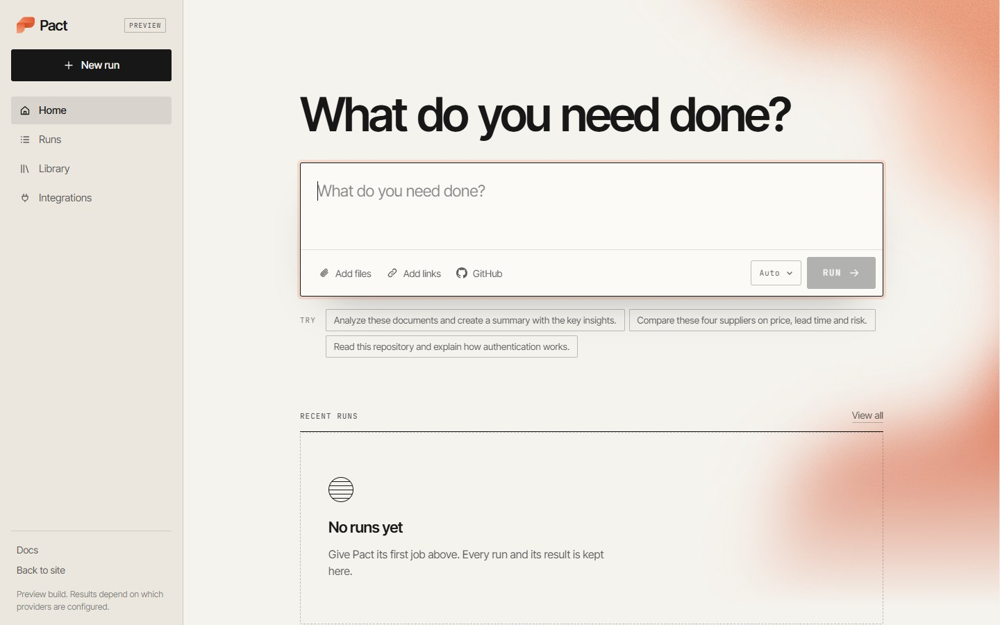
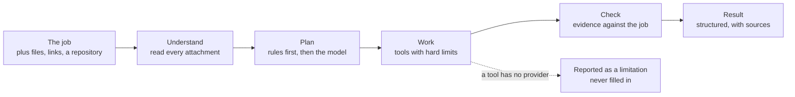
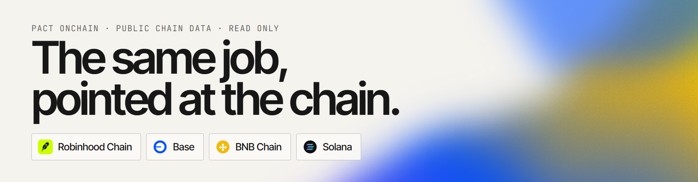
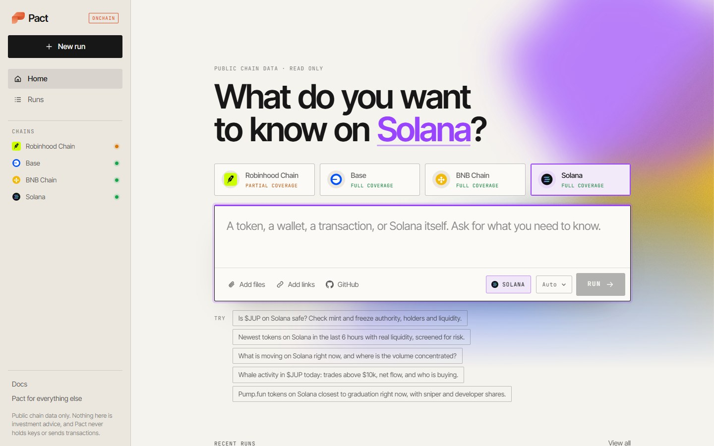
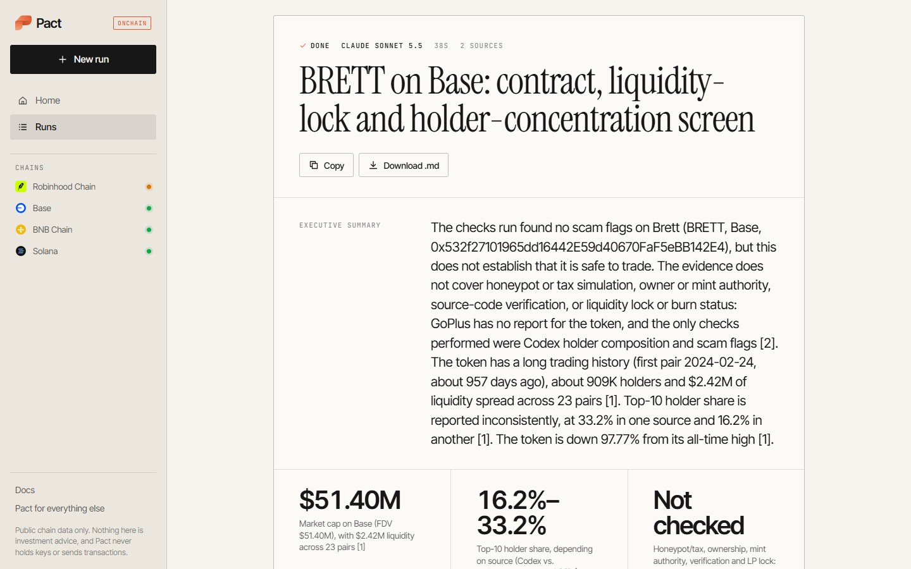

<a href="https://runpact.family"></a>

<table>
<tr>
<td><a href="https://runpact.family"><b>runpact.family</b></a><br>the site and the app</td>
<td><a href="https://docs.runpact.family"><b>docs.runpact.family</b></a><br>one guide for both surfaces</td>
<td><a href="https://onchain.runpact.family"><b>onchain.runpact.family</b></a><br>Pact for public chain data</td>
<td><a href="https://x.com/runpactfamily"><b>@runpactfamily</b></a><br>on X</td>
</tr>
</table>

# Pact

Pact is an autonomous work agent. You describe a job, hand over the context it
needs (files, links, a repository), and Pact works through it and returns a
finished document: a summary, the findings, the risks, a recommendation where
one is called for, and the sources behind every figure.

It is not a chat window. There is no back and forth to steer. You brief it once,
the way you would brief a capable colleague, and you get the work back.

| | |
|---|---|
|  |  |
| **The site.** What Pact is and how a job moves through it. | **The app.** One question, a composer, and your past runs. |

## What happens to a job



- **Real runs only.** Every step calls a real provider. If no model answers, the
  run fails with a clear error. Nothing is simulated and nothing is invented to
  fill a gap: a step that could not run is listed in the result's limitations.
- **A fixed result shape.** Executive summary, highlights, findings, risks,
  recommendation, sources. You always know where to look.
- **Model routing.** Light jobs go to a fast model; heavy research, code and
  multi-source analysis go to a stronger one, with fallbacks. You can also pick
  the model yourself, and the result names the one that did the work.
- **Files are read in code.** PDF, DOCX, XLSX, CSV, JSON, TXT and MD are parsed
  on the server, and table statistics are computed, not guessed.

<a href="https://onchain.runpact.family"></a>

## Pact Onchain

The same engine on a second surface, with thirteen more tools. Ask about a
token, a wallet, a transaction or a whole chain on **Robinhood Chain**, **Base**,
**BNB Chain** or **Solana**.

| | |
|---|---|
|  |  |
| **Pick a chain and ask.** Each chain shows how much of it is covered. | **A real result.** Where a check had no data, it says "Not checked". |

| Ask about | What comes back |
|---|---|
| A token | identity, price, liquidity, holders, age, all-time high, price history up to a year |
| Its safety | honeypot and tax checks, mint and freeze authority, ownership, holder concentration, liquidity locks |
| Its trading | volume across the last day, buy and sell pressure, large trades and net flow |
| Several tokens | up to six side by side in one table |
| A chain | what is trending, new launches screened for risk, screens by liquidity, age, holders and launchpad stage |
| DeFi | total value locked, largest protocols, stablecoin supply, yields |
| A wallet | holdings, recent activity, flagged addresses, risky approvals |
| A transaction | status, parties, decoded method, value, fee and transfers, in plain words |

Read only. Pact Onchain never asks for a wallet connection, holds no keys and
sends no transactions. A clean security screen is reported as "no flags found by
the checks run", never as "safe", and nothing it returns is investment advice.

## Run it yourself

Requires Node.js 22 or newer.

```sh
git clone https://github.com/runpactfamily/pact.git
cd pact
npm install
cp .env.example .env.local    # then add at least one model key
npm run dev
```

Open `http://localhost:3000/app` for Pact and `http://onchain.localhost:3000`
for Pact Onchain. The docs are at `http://localhost:3000/docs`.

Every key in `.env.example` is optional except one language model key
(OpenRouter, Gemini or Groq). Each tool reports itself as unavailable when its
provider has no key, and the run says so. Without Supabase, runs are kept as
JSON under `.pact-data/`; with it, apply the files in `supabase/migrations/`
first.

```sh
npm test            # 72 tests, no network
npm run check       # typecheck, lint, tests and a production build
```

## How it is built

One Next.js application serves three hosts. `src/proxy.ts` decides by hostname
which pages a request sees, so the site, the docs and Pact Onchain share one
deployment and one engine.

```
src/
  app/                 pages and API routes
    (site)/            landing, how it works, example jobs, docs, legal
    app/               Pact: composer, runs, library, integrations
    onchain/           Pact Onchain: composer, runs
    api/               runs, files, models, health, onchain chains
  components/          site, app, onchain, composer and run views
  server/
    agent/             planner, context, synthesizer, model and task routing
    tools/             the tool registry, one per surface
      onchain/         the thirteen chain tools
    providers/         language models, search, reader, crawl, GitHub
    onchain/           chains, host routing, one client per data source
    files/             parsers and table statistics
    runs/              run manager and write coalescing
    storage/, blobs/   Supabase or local disk, behind one interface each
  cloudflare/          the Worker entry and the Durable Object that executes runs
  proxy.ts             host routing
tests/                 node:test, no network
supabase/migrations/   database schema
scripts/               Worker build, secret upload, smoke tests against real APIs
docs/                  architecture, backend, onchain
```

Two rules hold the server together:

1. **Tools never talk to a vendor directly.** A tool asks a provider interface;
   the vendor behind it can be swapped in one file, and a missing key turns into
   "unavailable", not a crash.
2. **The registry is chosen per run.** A run from the app never sees the chain
   tools; an onchain run gets them on top of the general ones.

| Layer | What it uses |
|---|---|
| Framework | Next.js 16 (App Router), React 19, TypeScript, plain CSS |
| Models | Claude through OpenRouter for heavy jobs; Gemini and Groq for light ones and as fallbacks |
| Research | web search and page reading, each with a fallback vendor; crawling; the GitHub API |
| Chain data | public RPC, explorers, DEX and DeFi indexers, token security databases |
| Persistence | Supabase (Postgres and Storage), or local files in development |
| Hosting | Cloudflare Workers through OpenNext, runs executed in a Durable Object |

## Documentation

| | |
|---|---|
| [docs.runpact.family](https://docs.runpact.family) | the user guide: writing a job, reading a result, chains and coverage |
| [docs/architecture.md](docs/architecture.md) | the agent loop, model and provider routing, the run lifecycle |
| [docs/backend.md](docs/backend.md) | environment variables, the API, adding a tool or a provider, deploying |
| [docs/onchain.md](docs/onchain.md) | Pact Onchain: chains, the thirteen tools, data sources, hosts |

## Status

Pact is a preview. Runs are real and so are their limits.

- There are no accounts yet. Runs and files are scoped to a per-browser id.
- Runs cannot be deleted from the interface yet.
- Robinhood Chain has partial coverage: its market data comes from one indexer,
  and honeypot and tax checks are not available for it.
- Cloud storage, team workspaces and database integrations are planned, not
  available.

The [preview status](https://docs.runpact.family/?section=preview-status) page
is kept current and is the place to check before relying on something.

---

<sub>© 2026 Pact. The Pact name, mark and site design belong to Pact. No license has been granted for this source yet.</sub>
